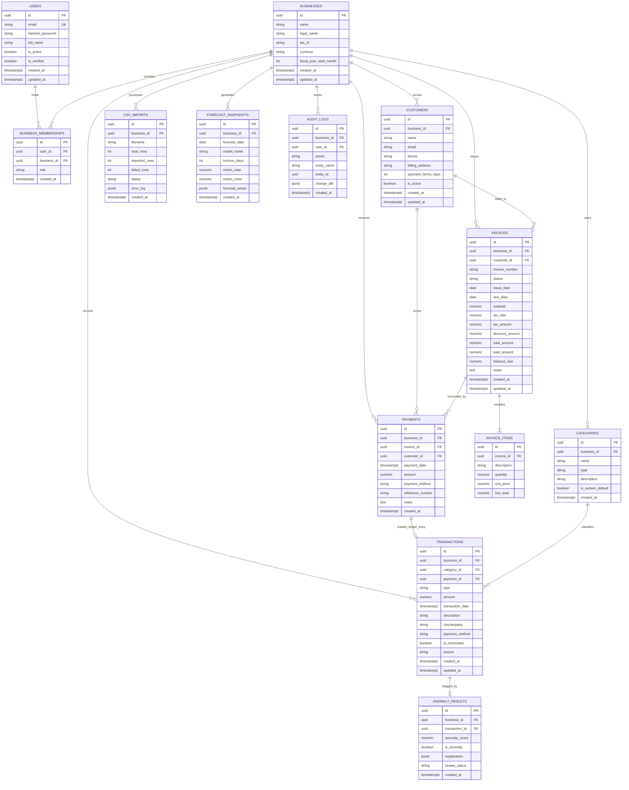

# DATABASE DESIGN SPECIFICATION: BIZFLOW AI

**Document Version:** 1.0.0
**Date:** November 2026
**Status:** Approved Architecture Baseline (Phase 0)
**Target RDBMS:** PostgreSQL 16+

---

## 1. Multi-Business Data Isolation Strategy

BizFlow AI employs a **Shared Database, Shared Schema with Discriminator Column (`business_id`)** pattern.

### 1.1 Tenant Isolation Guarantees
1. **Mandatory Discriminator:** Every business-owned entity (`categories`, `customers`, `invoices`, `invoice_items`, `payments`, `transactions`, `csv_imports`, `anomaly_results`, `forecast_snapshots`, `audit_logs`) includes a non-nullable foreign key column `business_id UUID REFERENCES businesses(id) ON DELETE CASCADE`.
2. **Compound Indexing:** All primary operational queries filter on `business_id`. Compound indexes starting with `business_id` (e.g., `INDEX idx_tx_biz_date ON transactions(business_id, transaction_date DESC)`) guarantee high query performance while enforcing tenant partition boundaries.
3. **ORM-Level Enforced Scoping:** All repository queries execute through base repository classes that inject `WHERE business_id = :active_business_id` by default.
4. **Defense-in-Depth Authorization & Uniform 404 Anti-Enumeration:** Before any record modification or retrieval by ID, the service layer verifies that `record.business_id == context.business_id`. If mismatched or if the user lacks membership, the server responds with `HTTP 404 Not Found` (to prevent leaking entity or workspace existence).
5. **Immediate Membership Revocation:** Access to a workspace is immediately revoked by deleting the corresponding `BusinessMembership` row. Subsequent requests with that `X-Business-ID` immediately return `HTTP 404 Not Found`.

---

## 2. Entity Relationship Diagram (ERD)

---

## 3. Data Dictionary & Table Specifications

### 3.1 `users`
System-wide authenticated user credentials.
- `id`: UUID, Primary Key, default `gen_random_uuid()`
- `email`: VARCHAR(255), NOT NULL, UNIQUE, index
- `hashed_password`: VARCHAR(255), NOT NULL
- `full_name`: VARCHAR(255), NOT NULL
- `is_active`: BOOLEAN, NOT NULL, DEFAULT true
- `is_verified`: BOOLEAN, NOT NULL, DEFAULT false
- `created_at`: TIMESTAMPTZ, NOT NULL, DEFAULT CURRENT_TIMESTAMP
- `updated_at`: TIMESTAMPTZ, NOT NULL, DEFAULT CURRENT_TIMESTAMP

### 3.2 `businesses`
Workspace entity representing a distinct business organization.
- `id`: UUID, Primary Key, default `gen_random_uuid()`
- `name`: VARCHAR(255), NOT NULL
- `legal_name`: VARCHAR(255), NULL
- `tax_id`: VARCHAR(50), NULL
- `currency`: VARCHAR(3), NOT NULL, DEFAULT 'USD' (ISO 4217 standard)
- `fiscal_year_start_month`: SMALLINT, NOT NULL, DEFAULT 1, CHECK (`fiscal_year_start_month BETWEEN 1 AND 12`)
- `created_at`: TIMESTAMPTZ, NOT NULL, DEFAULT CURRENT_TIMESTAMP
- `updated_at`: TIMESTAMPTZ, NOT NULL, DEFAULT CURRENT_TIMESTAMP

### 3.3 `business_memberships`
Role-based mapping of users to business workspaces.
- `id`: UUID, Primary Key
- `user_id`: UUID, NOT NULL, REFERENCES `users(id)` ON DELETE CASCADE
- `business_id`: UUID, NOT NULL, REFERENCES `businesses(id)` ON DELETE CASCADE
- `role`: VARCHAR(20), NOT NULL, CHECK (`role IN ('OWNER', 'ADMIN', 'MEMBER', 'VIEWER')`)
- `created_at`: TIMESTAMPTZ, NOT NULL, DEFAULT CURRENT_TIMESTAMP
- *Unique Constraint:* `UNIQUE(user_id, business_id)`
- *Indexes:* `idx_memberships_user (user_id)`, `idx_memberships_biz (business_id)`

### 3.4 `categories`
Income and expense chart of accounts categories.
- `id`: UUID, Primary Key
- `business_id`: UUID, NOT NULL, REFERENCES `businesses(id)` ON DELETE CASCADE
- `name`: VARCHAR(100), NOT NULL
- `type`: VARCHAR(20), NOT NULL, CHECK (`type IN ('INCOME', 'EXPENSE')`)
- `description`: VARCHAR(255), NULL
- `is_system_default`: BOOLEAN, NOT NULL, DEFAULT false
- `created_at`: TIMESTAMPTZ, NOT NULL, DEFAULT CURRENT_TIMESTAMP
- *Unique Constraint:* `UNIQUE(business_id, name, type)`
- *Index:* `idx_cat_biz (business_id)`

### 3.5 `customers`
Customer profiles for accounts receivable.
- `id`: UUID, Primary Key
- `business_id`: UUID, NOT NULL, REFERENCES `businesses(id)` ON DELETE CASCADE
- `name`: VARCHAR(255), NOT NULL
- `email`: VARCHAR(255), NULL
- `phone`: VARCHAR(50), NULL
- `billing_address`: TEXT, NULL
- `payment_terms_days`: INT, NOT NULL, DEFAULT 30, CHECK (`payment_terms_days >= 0`)
- `is_active`: BOOLEAN, NOT NULL, DEFAULT true
- `created_at`: TIMESTAMPTZ, NOT NULL, DEFAULT CURRENT_TIMESTAMP
- `updated_at`: TIMESTAMPTZ, NOT NULL, DEFAULT CURRENT_TIMESTAMP
- *Index:* `idx_cust_biz_name (business_id, name)`

### 3.6 `invoices`
Invoicing entity tracking receivables.
- `id`: UUID, Primary Key
- `business_id`: UUID, NOT NULL, REFERENCES `businesses(id)` ON DELETE CASCADE
- `customer_id`: UUID, NOT NULL, REFERENCES `customers(id)` ON DELETE RESTRICT
- `invoice_number`: VARCHAR(50), NOT NULL
- `status`: VARCHAR(20), NOT NULL, DEFAULT 'DRAFT', CHECK (`status IN ('DRAFT', 'SENT', 'PARTIALLY_PAID', 'PAID', 'OVERDUE', 'CANCELED')`)
- `issue_date`: DATE, NOT NULL
- `due_date`: DATE, NOT NULL, CHECK (`due_date >= issue_date`)
- `subtotal`: NUMERIC(15, 2), NOT NULL, CHECK (`subtotal >= 0`)
- `tax_rate`: NUMERIC(7, 4), NOT NULL, DEFAULT 0.0000, CHECK (`tax_rate >= 0`)
- `tax_amount`: NUMERIC(15, 2), NOT NULL, DEFAULT 0.00, CHECK (`tax_amount >= 0`)
- `discount_amount`: NUMERIC(15, 2), NOT NULL, DEFAULT 0.00, CHECK (`discount_amount >= 0`)
- `total_amount`: NUMERIC(15, 2), NOT NULL, CHECK (`total_amount >= 0`)
- `paid_amount`: NUMERIC(15, 2), NOT NULL, DEFAULT 0.00, CHECK (`paid_amount >= 0 AND paid_amount <= total_amount`)
- `balance_due`: NUMERIC(15, 2), NOT NULL, CHECK (`balance_due >= 0`)
- `notes`: TEXT, NULL
- `created_at`: TIMESTAMPTZ, NOT NULL, DEFAULT CURRENT_TIMESTAMP
- `updated_at`: TIMESTAMPTZ, NOT NULL, DEFAULT CURRENT_TIMESTAMP
- *Unique Constraint:* `UNIQUE(business_id, invoice_number)`
- *Indexes:* `idx_inv_biz_status (business_id, status)`, `idx_inv_biz_due (business_id, due_date)`

### 3.7 `invoice_items`
Line items for invoices.
- `id`: UUID, Primary Key
- `invoice_id`: UUID, NOT NULL, REFERENCES `invoices(id)` ON DELETE CASCADE
- `description`: VARCHAR(255), NOT NULL
- `quantity`: NUMERIC(10, 2), NOT NULL, CHECK (`quantity > 0`)
- `unit_price`: NUMERIC(15, 2), NOT NULL, CHECK (`unit_price >= 0`)
- `line_total`: NUMERIC(15, 2), NOT NULL, CHECK (`line_total >= 0`)
- *Index:* `idx_inv_items_inv (invoice_id)`

### 3.8 `payments`
Recorded payments toward invoices or direct customer payments.
- `id`: UUID, Primary Key
- `business_id`: UUID, NOT NULL, REFERENCES `businesses(id)` ON DELETE CASCADE
- `invoice_id`: UUID, NULL, REFERENCES `invoices(id)` ON DELETE SET NULL
- `customer_id`: UUID, NULL, REFERENCES `customers(id)` ON DELETE SET NULL
- `payment_date`: TIMESTAMPTZ, NOT NULL, DEFAULT CURRENT_TIMESTAMP
- `amount`: NUMERIC(15, 2), NOT NULL, CHECK (`amount > 0`)
- `payment_method`: VARCHAR(30), NOT NULL, CHECK (`payment_method IN ('CASH', 'BANK_TRANSFER', 'CREDIT_CARD', 'CHECK', 'OTHER')`)
- `reference_number`: VARCHAR(100), NULL
- `notes`: TEXT, NULL
- `created_at`: TIMESTAMPTZ, NOT NULL, DEFAULT CURRENT_TIMESTAMP
- *Index:* `idx_pay_biz_date (business_id, payment_date DESC)`

### 3.9 `transactions`
Double-entry aligned core operational ledger records.
- `id`: UUID, Primary Key
- `business_id`: UUID, NOT NULL, REFERENCES `businesses(id)` ON DELETE CASCADE
- `category_id`: UUID, NULL, REFERENCES `categories(id)` ON DELETE SET NULL
- `payment_id`: UUID, NULL, REFERENCES `payments(id)` ON DELETE SET NULL
- `type`: VARCHAR(20), NOT NULL, CHECK (`type IN ('INCOME', 'EXPENSE', 'TRANSFER')`)
- `amount`: NUMERIC(15, 2), NOT NULL, CHECK (`amount > 0`)
- `transaction_date`: TIMESTAMPTZ, NOT NULL
- `description`: VARCHAR(255), NOT NULL
- `counterparty`: VARCHAR(255), NULL
- `payment_method`: VARCHAR(30), NOT NULL, DEFAULT 'BANK_TRANSFER'
- `is_reconciled`: BOOLEAN, NOT NULL, DEFAULT false
- `source`: VARCHAR(20), NOT NULL, DEFAULT 'MANUAL', CHECK (`source IN ('MANUAL', 'CSV_IMPORT', 'INVOICE_PAYMENT')`)
- `created_at`: TIMESTAMPTZ, NOT NULL, DEFAULT CURRENT_TIMESTAMP
- `updated_at`: TIMESTAMPTZ, NOT NULL, DEFAULT CURRENT_TIMESTAMP
- *Indexes:*
  - `idx_tx_biz_date (business_id, transaction_date DESC)`
  - `idx_tx_biz_cat (business_id, category_id)`
  - `idx_tx_biz_type (business_id, type)`

### 3.10 `anomaly_results`
Machine learning flagged transaction anomalies.
- `id`: UUID, Primary Key
- `business_id`: UUID, NOT NULL, REFERENCES `businesses(id)` ON DELETE CASCADE
- `transaction_id`: UUID, NOT NULL, REFERENCES `transactions(id)` ON DELETE CASCADE
- `anomaly_score`: NUMERIC(7, 4), NOT NULL
- `is_anomaly`: BOOLEAN, NOT NULL, DEFAULT false
- `explanation`: JSONB, NOT NULL (contains feature attribution, z-score, category comparison)
- `review_status`: VARCHAR(30), NOT NULL, DEFAULT 'PENDING', CHECK (`review_status IN ('PENDING', 'CONFIRMED_NORMAL', 'CONFIRMED_ANOMALOUS')`)
- `created_at`: TIMESTAMPTZ, NOT NULL, DEFAULT CURRENT_TIMESTAMP
- *Unique Constraint:* `UNIQUE(transaction_id)`
- *Index:* `idx_anomaly_biz (business_id, is_anomaly, review_status)`

### 3.11 `csv_imports`
Batch ingestion tracking and audit log.
- `id`: UUID, Primary Key
- `business_id`: UUID, NOT NULL, REFERENCES `businesses(id)` ON DELETE CASCADE
- `filename`: VARCHAR(255), NOT NULL
- `total_rows`: INT, NOT NULL, DEFAULT 0
- `imported_rows`: INT, NOT NULL, DEFAULT 0
- `failed_rows`: INT, NOT NULL, DEFAULT 0
- `status`: VARCHAR(20), NOT NULL, DEFAULT 'PENDING', CHECK (`status IN ('PENDING', 'PROCESSED', 'FAILED')`)
- `error_log`: JSONB, NULL
- `created_at`: TIMESTAMPTZ, NOT NULL, DEFAULT CURRENT_TIMESTAMP
- *Index:* `idx_csv_biz (business_id, created_at DESC)`

### 3.12 `forecast_snapshots`
Cached predictive model outputs.
- `id`: UUID, Primary Key
- `business_id`: UUID, NOT NULL, REFERENCES `businesses(id)` ON DELETE CASCADE
- `forecast_date`: DATE, NOT NULL
- `model_name`: VARCHAR(50), NOT NULL
- `horizon_days`: INT, NOT NULL, DEFAULT 30
- `metric_mae`: NUMERIC(12, 4), NULL
- `metric_rmse`: NUMERIC(12, 4), NULL
- `forecast_series`: JSONB, NOT NULL (date, predicted_balance, lower_bound, upper_bound)
- `created_at`: TIMESTAMPTZ, NOT NULL, DEFAULT CURRENT_TIMESTAMP
- *Index:* `idx_forecast_biz (business_id, forecast_date DESC)`

### 3.13 `audit_logs`
Immutable administrative audit log.
- `id`: UUID, Primary Key
- `business_id`: UUID, NOT NULL, REFERENCES `businesses(id)` ON DELETE CASCADE
- `user_id`: UUID, NULL, REFERENCES `users(id)` ON DELETE SET NULL
- `action`: VARCHAR(50), NOT NULL (e.g., `INVOICE_CREATED`, `PAYMENT_RECORDED`)
- `entity_name`: VARCHAR(50), NOT NULL
- `entity_id`: UUID, NOT NULL
- `change_diff`: JSONB, NULL
- `created_at`: TIMESTAMPTZ, NOT NULL, DEFAULT CURRENT_TIMESTAMP
- *Index:* `idx_audit_biz (business_id, created_at DESC)`
