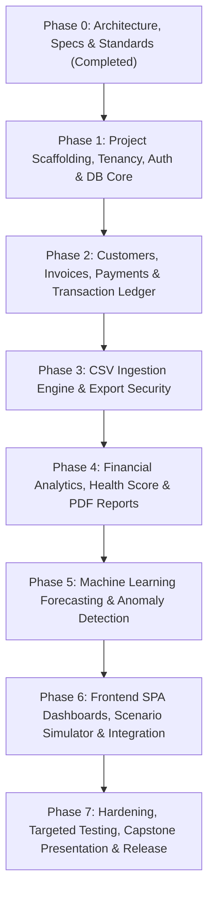

# DEVELOPMENT ROADMAP & MILESTONES: BIZFLOW AI

**Document Version:** 1.1.0
**Date:** November 2026
**Status:** Approved Architecture Baseline (Phase 0)
**Development Model:** Solo Developer Sequential Progression

---

## 1. Roadmap Strategy for Solo Development

Because BizFlow AI is built by one primary developer, the roadmap is structured as a **linear, feature-by-feature progression**. Each phase establishes a solid foundation before the next begins.

> [!IMPORTANT]
> **Developer Gatekeeper Rule:** The AI assistant must implement one feature at a time, verify it with relevant tests, and obtain explicit developer review before proceeding to subsequent phases or milestones.

---

## 2. Phase Breakdown & Acceptance Criteria

### Phase 0: Architecture, Specifications & Standards Baseline (Current)
- **Goal:** Establish permanent architectural guardrails, data models, API contracts, and development rules.
- **Deliverables:**
  - `AGENTS.md` (Solo developer operating guidelines & security rules).
  - `docs/PROJECT_CHARTER.md` (Problem statement, functional/NFR requirements).
  - `docs/SYSTEM_ARCHITECTURE.md` (Modular monolith layout, data flows).
  - `docs/DATABASE_DESIGN.md` (PostgreSQL schemas, constraints, tenant isolation).
  - `docs/API_CONTRACT.md` (REST routes with RFC 9457 Problem Details).
  - `docs/TEAM_RESPONSIBILITIES.md` (Solo developer model & support matrix).
  - `docs/DEVELOPMENT_ROADMAP.md` (This document).
  - `docs/ARCHITECTURE_DECISIONS.md` (ADRs 001–010).
- **Exit Criteria:** Architectural sign-off by primary developer; zero implementation code written.

---

### Phase 1: Project Scaffolding, Tenancy, Auth & Database Core (COMPLETED)
- **Status:** Formally Accepted & Verified across Checkpoints 1 through 5.
- **Checkpoints Delivered:**
  - Checkpoint 1: Repository Foundation (`pyproject.toml`, FastAPI app factory, `core/config.py`).
  - Checkpoint 2: Database Foundation (`0001_initial_core_schema.py`, declarative models, constraints).
  - Checkpoint 3: Registration & Authentication (`/auth/register`, `/auth/login`, `/auth/me`, JWT HS256, bcrypt dummy-hash timing mitigation).
  - Checkpoint 4: Multi-Tenant Workspace Context (`X-Business-ID`, `CurrentBusinessDep`, uniform 404 anti-enumeration, `RequireRoles` RBAC, `assert_not_last_owner`, `/workspaces`).
  - Checkpoint 5: Integration, Frontend Shell, Client Architecture & Documentation (`api.ts`, `AuthContext`, `WorkspaceContext`, Vitest suite with 35 tests, SQLite suite with 85 tests, opt-in PostgreSQL test architecture, production build).
- **Exit Criteria Status:**
  - 100% passing test suite across critical paths (85 backend SQLite tests, 35 frontend tests).
  - Multi-tenant isolation verified with zero cross-tenant leakage.
  - Zero payload override demonstrated.
  - Candidate-probe isolation verified.
  - Opt-in PostgreSQL test suite created with strict `bizflow_test` validation (PostgreSQL runtime execution UNVERIFIED locally).
  - Formal gate transition to Phase 2 enabled.

---

### Phase 2: Customers, Invoices, Payments & Transaction Ledger
- **Goal:** Build the operational backbone: invoicing lifecycle, payment recording, and transaction ledger.
- **Deliverables:**
  - Categories and Chart of Accounts seed service.
  - Customer CRUD endpoints with payment terms.
  - Multi-line invoice CRUD with exact `Decimal` arithmetic for subtotals, taxes, discounts, and totals.
  - Invoice state machine (`DRAFT` $\to$ `SENT` $\to$ `PARTIALLY_PAID` $\to$ `PAID` $\to$ `OVERDUE` $\to$ `CANCELED`).
  - Payment recording service executing within an atomic DB transaction (`db.begin()`):
    - Updates invoice `paid_amount` and `balance_due`.
    - Automatically updates invoice status to `PAID` or `PARTIALLY_PAID`.
    - Creates a matching ledger transaction record.
  - Transaction ledger CRUD (income, expenses, transfers).
- **Acceptance Criteria:**
  - Targeted unit tests prove exact `Decimal` calculations (zero floating-point drift).
  - Atomic transaction rollback test: payment failure does not leave orphaned invoice status.
  - Database check constraints prevent negative balances (`balance_due >= 0`).

---

### Phase 3: CSV Ingestion Engine & Secure Export
- **Goal:** Provide bulk transaction data import and secure CSV reporting.
- **Deliverables:**
  - CSV file upload, MIME type validation, and file size enforcement ($\le 10\text{ MB}$).
  - Column mapping preview endpoint (suggesting matching fields).
  - Row-by-row validation, sanitization, and atomic batch commit.
  - Detailed error reporting for malformed rows without aborting valid transactions.
  - CSV export service implementing spreadsheet formula injection defense (prefixing dangerous characters `=`, `+`, `-`, `@`, `\t`, `\r` with `'`).
- **Acceptance Criteria:**
  - Malformed CSVs return structured row error summaries.
  - Exported CSV files safely neutralize formula injection triggers in Excel and Google Sheets.

---

### Phase 4: Financial Analytics, Health Score & PDF Reports
- **Goal:** Implement financial metrics, P&L generation, health scoring, and archival reporting.
- **Deliverables:**
  - Analytics summary endpoint: Total Revenue, Total Expenses, Net Margin, Cash on Hand.
  - Monthly and Quarterly Profit & Loss (P&L) statement generation.
  - Realized Cash Flow breakdown (Inflows vs. Outflows).
  - Rule-based Financial Health Score (0–100) across 4 weighted pillars with explicit disclaimers.
  - ReportLab PDF generator producing branded financial summary reports.
- **Acceptance Criteria:**
  - P&L numbers mathematically match ledger sums exactly.
  - Health score provides transparent breakdown of scoring weights and metrics.
  - PDF generation completes in $< 1.5\text{ s}$ locally without external browser daemons.

---

### Phase 5: Machine Learning Forecasting & Anomaly Detection
- **Goal:** Add intelligent decision support through time-series forecasting and transaction anomaly detection.
- **Deliverables:**
  - Daily net cash balance aggregation pipeline.
  - Moving-average baseline model.
  - Statsmodels Holt-Winters / ARIMA forecasting with 80% and 95% confidence intervals.
  - Chronological train/test split evaluation reporting MAE and RMSE metrics.
  - Graceful fallback with clear warnings (`INSUFFICIENT_DATA_FOR_ML`) for sparse data ($< 30$ days).
  - Scikit-learn `IsolationForest` transaction anomaly detector with feature engineering.
  - Human-readable explainability generator detailing driver factors for flagged transactions.
  - What-If Scenario simulator projecting cash runway based on parameterized sliders.
- **Acceptance Criteria:**
  - No data leakage: strictly chronological evaluation.
  - Anomalies labeled as "Unusual Activity" without accusations of fraud.
  - Zero unhandled exceptions on edge cases (zero variance, small sample sizes).

---

### Phase 6: Frontend SPA Dashboards, Scenario Simulator & Integration
- **Goal:** Deliver an intuitive, responsive React web interface connecting all backend APIs.
- **Deliverables:**
  - Vite + React 18/19 SPA with TypeScript strict mode and Tailwind CSS.
  - Global navigation, workspace switcher dropdown, and JWT auth route guards.
  - TanStack Query client with tenant-scoped query caching and automatic 401 token refresh.
  - Transaction ledger table with search, category filtering, and manual creation modal.
  - Multi-line invoice builder with real-time tax/discount previews and payment recording modal.
  - CSV upload dropzone with column mapping preview.
  - Recharts financial dashboard (revenue/expense charts, cash flow trajectory with forecast ribbon).
  - Anomaly review queue with expandable explainability cards.
  - Interactive What-If Scenario simulator with dynamic slider controls.
- **Acceptance Criteria:**
  - Zero non-functional buttons or mock placeholders.
  - Switching workspaces invalidates frontend query caches immediately (no data leakage).
  - Clean error banners rendering RFC 9457 Problem Details.

---

### Phase 7: Hardening, Targeted Testing, Capstone Presentation & Release
- **Goal:** Final quality assurance, security verification, documentation completion, and capstone packaging.
- **Deliverables:**
  - Comprehensive targeted test suite execution (financial math, security, tenancy, ML edge cases).
  - End-to-end user journey validation with supporting team members conducting manual QA.
  - Complete README, local setup instructions (`docker-compose up`), and API reference.
  - Capstone presentation slide deck and live demonstration script prepared by supporting members.
  - GitHub repository finalized for open-source publication.
- **Acceptance Criteria:**
  - Application runs completely from scratch with one command: `docker-compose up`.
  - Zero cross-tenant leakage or formula injection vulnerabilities detected.
  - Capstone evaluation requirements fully satisfied.
