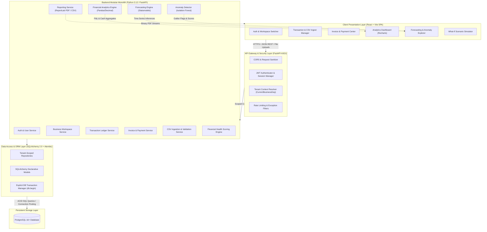

# SYSTEM ARCHITECTURE: BIZFLOW AI

**Document Version:** 1.0.0
**Date:** November 2026
**Status:** Approved Architecture Baseline (Phase 0)

---

## 1. Architectural Philosophy & Style

BizFlow AI is architected as a **Modular Monolith**.

For a platform targeting small business financial intelligence, a modular monolith provides the ideal balance:
- **High Cohesion & Low Coupling:** Logical boundaries between domain modules (Auth, Invoices, Transactions, Analytics, ML, Reports) are strictly enforced in code.
- **ACID Transaction Guarantees:** Financial transactions, invoice status updates, and payment reconciliation require strict database-level transactional guarantees that are robust and simple in a single relational store without distributed two-phase commits.
- **Operational Simplicity:** Low operational overhead for academic demonstration and open-source deployment, while remaining forward-compatible with microservice extraction should independent scaling be needed in the future.

### 1.1 Client Integration Architecture & Security Boundaries (Phase 1, Checkpoint 5)

The client presentation layer is a React 18 Single-Page Application (SPA) communicating with the FastAPI backend via a centralized, typed API client (`frontend/src/lib/api.ts`).

1. **Mandatory Request Scopes & Option Destructuring:**
   - Every API request explicitly declares a `scope`:
     - `public`: No `Authorization` or `X-Business-ID` headers (login, register, health probe).
     - `auth`: Injects `Authorization: Bearer <token>`, but never sends `X-Business-ID` (`/auth/me`, `/workspaces`).
     - `workspace`: Injects both `Authorization: Bearer <token>` and `X-Business-ID: <business_id>` (`/workspaces/current`).
   - Application options (`scope`, `targetWorkspaceId`) are destructured before passing native options to `fetch`, guaranteeing zero option leakage into `RequestInit`.
   - `credentials: 'omit'` is enforced unconditionally on all requests, preventing ambient browser cookie CSRF attack vectors.

2. **Deterministic Response Parsing Contract:**
   - HTTP 204 or empty response returns `undefined` without JSON parsing.
   - Successful JSON response parses payload; malformed JSON on success throws `ApiClientError` (protocol error, never `NetworkError`).
   - Successful non-JSON response when JSON expected throws `ApiClientError` (protocol error, never `NetworkError`).
   - Valid RFC 9457 error response parses into `ApiClientError` with structured problem details.
   - Malformed JSON error or HTML (e.g. 502 Bad Gateway) returns `ApiClientError` with HTTP status and safe fallback message.
   - `NetworkError` strictly represents fetch-level connectivity failures (`TypeError`).

3. **Authentication & Workspace Lifecycle Coordination:**
   - Nested providers: `<AuthProvider><WorkspaceProvider><AppRoutes /></WorkspaceProvider></AuthProvider>`. `AuthProvider` never imports or depends on `WorkspaceProvider`.
   - **Auth Loading State Distinction:** `WorkspaceProvider` observes `isLoading`. Saved workspace IDs in `sessionStorage` are strictly preserved during initial auth verification and network failures. State is cleared only when an established authenticated session transitions to unauthenticated (logout or authenticated 401).
   - **Candidate-Probe Isolation:** Switching workspaces probes candidate targets using `targetWorkspaceId` without modifying active workspace state. If a candidate probe returns HTTP 404 `BUSINESS_NOT_FOUND`, the error is caught locally, preserving the active workspace and `sessionStorage`. Active workspace invalidation occurs strictly when an operational request targeting the currently active workspace receives `BUSINESS_NOT_FOUND`.
   - **Stale Async Guard:** Sequence counters (`requestSeqRef`) ensure outdated asynchronous responses or candidate probes cannot overwrite newer user selections or restore state after logout.

4. **Authoritative Boundary:**
   - Frontend UI role badges and selector states are **strictly informational**. Server-side dependencies (`CurrentUserDep`, `WorkspaceContext`, `RequireRoles`) remain authoritative on every request.



---

## 3. Component Responsibilities

### 3.1 Client Layer (Frontend SPA)
- **Role:** Single Page Application (SPA) built using React 18/19, Vite, TypeScript, and Tailwind CSS.
- **Responsibilities:**
  - Client-side routing with role-based route guards (`/login`, `/dashboard`, `/invoices`, `/transactions`, `/analytics`, `/forecasting`, `/reports`).
  - Active workspace state management (switching between business entities via global header dropdown).
  - High-performance data visualization utilizing Recharts for cash flow trajectories, P&L breakdowns, and confidence intervals.
  - Form validation with reactive feedback (preventing invalid submissions before hitting the API).
  - Secure token storage in memory/secure storage with automatic silent token refresh via Axios/Fetch interceptors.

### 3.2 API Gateway & Middleware Layer
- **Role:** Entry point for all HTTP traffic handled by FastAPI.
- **Responsibilities:**
  - **CORS Handling:** Strict origin whitelisting for web clients.
  - **Authentication:** Decodes and validates JWT bearer tokens; extracts user identity.
  - **Tenant Resolution (`CurrentBusinessDep`):** Inspects the `X-Business-ID` header or route parameter, verifies that the authenticated user possesses active membership/roles in that business, and binds the validated business ID to request context.
  - **Global Error Handling:** Intercepts domain exceptions and translates them to standard RFC 9457 error envelopes.

### 3.3 Core Domain Services (Modular Monolith)

#### A. Auth & Workspace Module (`app/services/auth.py`, `app/services/business.py`)
- Manages user credentials with `bcrypt` password hashing.
- Issues short-lived access JWTs and cryptographically secure refresh tokens.
- Manages business workspace profiles, company settings, and user-business membership associations (`Owner`, `Admin`, `Member`, `Viewer`).

#### B. Transaction & Ledger Module (`app/services/transaction.py`)
- Records income, expenses, and inter-category transfers.
- Enforces strict classification with predefined and custom chart of accounts / categories.
- Ensures all monetary amounts are stored as exact decimals (`Decimal`).

#### C. Invoicing & Payment Module (`app/services/invoice.py`, `app/services/payment.py`)
- Manages customer entities and contact details.
- Handles multi-item invoice lifecycle with state machine validation:
  $$\text{Draft} \longrightarrow \text{Sent} \longrightarrow (\text{Partially Paid}) \longrightarrow \text{Paid} \lor \text{Overdue} \lor \text{Canceled}$$
- Records payment receipts and automatically updates remaining balances and status within an atomic transaction.

#### D. CSV Ingestion Engine (`app/services/csv_import.py`)
- Validates external CSV files (MIME type, file size $\le 10\text{ MB}$, column headers).
- Sanitizes rows against CSV injection attacks.
- Provides preview mapping (matching external column headers to BizFlow AI fields).
- Executes batch validation and transactional bulk insertion.

#### E. Financial Analytics Engine (`app/analytics/`)
- Computes aggregated financial summaries:
  - Total Revenue, Total Cost of Goods Sold (COGS), Operating Expenses (OPEX), Gross Profit, Net Operating Margin.
  - Trailing P&L statements across customizable monthly/quarterly buckets.
  - Realized Cash Flow (Operating, Investing, Financing cash movements).
- Uses Pandas and Python `Decimal` to ensure exact mathematical precision.

#### F. Machine Learning & Forecasting Module (`app/ml/`)
- **Cash Flow Forecasting:**
  - Extracts daily net cash balance time series.
  - Implements a statistical baseline (Moving Average / Drift) alongside Statsmodels Holt-Winters / ARIMA / SARIMAX models.
  - Employs strict chronological train/test splitting to prevent data leakage.
  - Computes predictive metrics (Mean Absolute Error, Root Mean Squared Error) and generates 80% and 95% confidence bounds.
- **Anomaly Detection:**
  - Extracts transactional features (transaction amount, day of week, hour of day, frequency per category, amount $z$-score relative to category historical baseline).
  - Fits Scikit-learn `IsolationForest` on normal baseline behavior.
  - Emits anomaly severity scores and explainability factors (e.g., "Amount is 4.2x above historical category mean").
  - Categorizes findings as *Unusual Activity*—never automatically accuses fraud.
- **Financial Health Scoring:**
  - Computes an explainable 0–100 score based on 4 transparent pillars:
    1. Liquidity (Current Ratio / Cash Runway in months) — 30% weight
    2. Profitability (Operating Margin %) — 25% weight
    3. Revenue Stability (Month-over-Month consistency) — 25% weight
    4. Receivable Health (Days Sales Outstanding & Overdue % ) — 20% weight
  - Accompanied by prominent disclaimers that it is an automated analytical aid, not a certified CPA opinion.

#### G. Reporting Module (`app/reporting/`)
- Generates downloadable CSV exports for all transaction tables.
- Utilizes **ReportLab** to programmatically generate clean, professional, branded PDF financial reports (P&L, Executive Cash Flow Summary).

---

## 4. Backend Architecture & Layering

The backend enforces strict separation of concerns through a 4-tier clean architecture pattern:

```
[ HTTP Request ]
       │
       ▼
┌────────────────────────────────────────────────────────┐
│ 1. API Route Layer (FastAPI Routers)                   │
│    - Defines HTTP endpoints, routes, methods           │
│    - Validates inputs via Pydantic Schemas             │
│    - Injects CurrentUserDep & CurrentBusinessDep       │
└───────────────────────┬────────────────────────────────┘
                        │
                        ▼
┌────────────────────────────────────────────────────────┐
│ 2. Business Service Layer                              │
│    - Pure domain logic & business rules                │
│    - Transaction orchestration (atomic blocks)         │
│    - Invokes Analytics & ML engines                    │
└───────────────────────┬────────────────────────────────┘
                        │
                        ▼
┌────────────────────────────────────────────────────────┐
│ 3. Repository / Data Access Layer                      │
│    - Interacts with SQLAlchemy 2.0 ORM                 │
│    - Enforces mandatory WHERE business_id = :id filters│
│    - Handles pagination, sorting, and eager loading    │
└───────────────────────┬────────────────────────────────┘
                        │
                        ▼
┌────────────────────────────────────────────────────────┐
│ 4. Database Storage Layer                              │
│    - PostgreSQL tables with CHECK & FK constraints     │
└────────────────────────────────────────────────────────┘
```

---

## 5. Frontend Architecture & State Management

```
┌────────────────────────────────────────────────────────┐
│ UI Components (Tailwind CSS + Headless UI Primitives)  │
└──────────────────────────┬─────────────────────────────┘
                           │
                           ▼
┌────────────────────────────────────────────────────────┐
│ Feature Modules (Invoices, Ledger, Analytics, etc.)    │
└──────────────────────────┬─────────────────────────────┘
                           │
                           ▼
┌────────────────────────────────────────────────────────┐
│ Data Layer: TanStack Query (React Query) Hooks         │
│ - Cache management, optimistic updates, query keys     │
│ - Scoped by ['business', activeBusinessId, 'resource'] │
└──────────────────────────┬─────────────────────────────┘
                           │
                           ▼
┌────────────────────────────────────────────────────────┐
│ API Client (Axios / Fetch with Interceptors)           │
│ - Automatically injects Authorization & X-Business-ID  │
│ - Handles 401 token refresh queue                      │
│ - Normalizes error messages via RFC 9457 handler       │
└────────────────────────────────────────────────────────┘
```

---

## 6. End-to-End Data Flows

### 6.1 Tenant-Scoped Request Flow
1. Client issues request: `GET /api/v1/invoices` with headers:
   - `Authorization: Bearer <jwt_token>`
   - `X-Business-ID: <business_uuid>`
2. FastAPI dependency `get_current_user` extracts `user_id` from JWT.
3. FastAPI dependency `get_current_business` queries `business_memberships` to verify `(user_id, business_id)` association and retrieves the user's role.
4. Route handler invokes `InvoiceService.get_invoices(business_id, ...)`.
5. SQLAlchemy query executes:
   ```sql
   SELECT * FROM invoices
   WHERE business_id = :business_id
   ORDER BY issue_date DESC LIMIT :limit OFFSET :offset;
   ```
6. Domain entities are converted into Pydantic response models and returned as JSON.

### 6.2 ML Forecasting Pipeline Flow
1. User requests cash flow forecast for next 30 days via dashboard.
2. `MLForecastingService` queries daily aggregated cash balances for that business over the past 180+ days.
3. If dataset has $< 30$ historical days, returns a structured warning: `INSUFFICIENT_DATA_FOR_ML` along with simple historical average baseline.
4. If dataset is sufficient:
   - Transforms series to regular frequency, imputing missing days with zero-delta forward fills.
   - Evaluates baseline model vs. Holt-Winters Exponential Smoothing / ARIMA.
   - Computes chronological validation score (MAE/RMSE).
   - Generates 30-day forecast with confidence intervals.
5. Returns typed payload to frontend; Recharts visualizes historical actuals with future forecast boundary ribbon.
